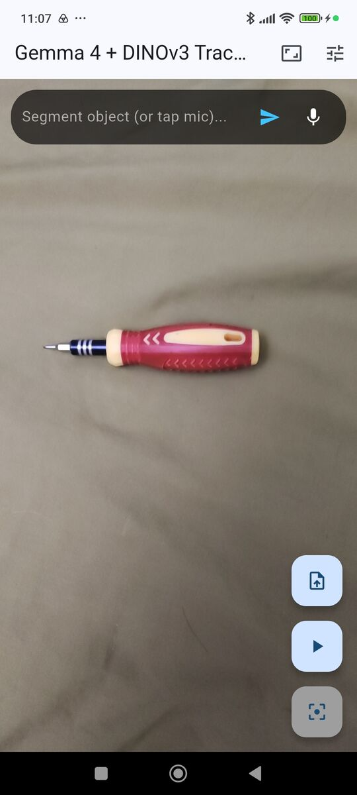
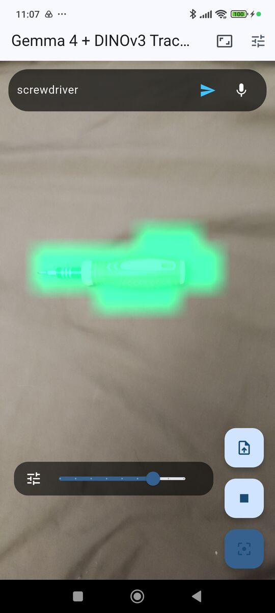

# Gemma 4 + EdgeTAM + DINOv3 Zero-Shot Segmentation & Tracking (Flutter Edge AI)

> ⚠️ **Platform Notice:** Currently, only **Android** is supported. This application uses a hybrid native architecture combining Android JNI (`LiteRT-LM`) and C++ FFI (`ONNX Runtime` + `OpenCV`).

A Flutter Edge AI application demonstrating **on-device, zero-shot multimodal object segmentation and real-time tracking**. By combining **Gemma 4 (`gemma-4-E2B-it.litertlm`)** via Google's LiteRT-LM with **EdgeTAM (Segment Anything)** and **DINOv3** via ONNX Runtime and OpenCV in C++, users can simply **speak** or **type** the name of any object in the camera view to automatically ground, segment, export, and track it in real time—with zero cloud dependencies.

---

## 📷 Screenshots
 

## 🧠 System 1 / System 2 Edge AI Architecture

This repository implements a **Slow-Fast Visual Pipeline** that partitions workloads across your Android device's hardware accelerators:

| Component | Model | Runtime & Bridge | Compute Target | Role in Pipeline |
| :--- | :--- | :--- | :--- | :--- |
| **System 2 (Slow / On-Demand Grounding)** | **Gemma 4 E2B** (`model.litertlm`) | LiteRT-LM via **`jnigen` JNI** (`LitertBridge.kt`) | **GPU** (Vision & Language w/ Speculative Decoding) + **CPU** (Audio) | **Zero-Shot Multimodal Grounding:** Processes a single camera frame + voice WAV ($16\text{ kHz}$ mono) or text prompt to locate the target `[ymin, xmin, ymax, xmax]`. |
| **Segmentation Bridge (On-Demand Masking)** | **EdgeTAM / SAM 2** (`edgetam_encoder.onnx`, `edgetam_decoder.onnx`) | ONNX Runtime `1.30.0` + OpenCV `5.0.0` via **Dart FFI** (`native_segmentation.cpp`) | **Multi-thread CPU** | **Box-Prompted Instance Segmentation:** Converts Gemma 4's bounding box into a pixel-accurate $256 \times 256$ foreground mask, applies morphological cleanup, and pools foreground DINOv3 patch features into an object prototype. |
| **System 1 (Fast Loop)** | **DINOv3** (`dinov3_feature_extractor.onnx`) | ONNX Runtime `1.30.0` + OpenCV `5.0.0` via **Dart FFI** (`StatefulIsolate`) | **NNAPI (NPU)** / Multi-thread CPU | **Real-Time Tracking ($15\text{--}30\text{ FPS}$):** Computes dense patch features, cosine similarity masks, and largest connected-component filtering on live `YUV420` camera frames. |

---

## ✨ Key Features

* **Zero-Shot Voice & Text Enrollment:** Point the camera at an object and say *"coffee mug"* (via a 5-second $16\text{ kHz}$ mono WAV recording) or type a description. No pre-cut images required.
* **EdgeTAM Box-Prompted Prototype Extraction:** Uses Gemma 4's detected bounding box (`[ymin, xmin, ymax, xmax]`) as a box prompt for EdgeTAM in C++ (`1024x1024` input) to generate a precise foreground mask, automatically selecting the highest-IoU candidate and running OpenCV morphological closing/opening before pooling DINOv3 patch embeddings.
* **Transparent RGBA PNG Cutout Export:** Save any Gemma 4 + EdgeTAM segmented object directly to your device gallery as a 4-channel transparent RGBA PNG (`gal`). Preserves straight (unpremultiplied) RGB scene context under transparent pixels so re-importing the PNG later maintains full Vision Transformer self-attention consistency and high similarity thresholds.
* **Fallback 1-Shot Gallery Enrollment:** Support for uploading a pre-masked RGBA PNG with transparency from the device gallery.
* **Stride-Aware Native Camera Pipeline:** De-interleaves Android `YUV_420_888` (`NV21`/`NV12`) chroma planes using `bytesPerRow` and `bytesPerPixel` into contiguous planar `I420` buffers before passing to C++ via FFI for accurate OpenCV RGB conversion, rotation, and ONNX inference inside a background `StatefulIsolate`.
* **Multi-Token Prediction (MTP):** Enables experimental speculative decoding on the LiteRT-LM GPU backend for fast Gemma 4 coordinate generation.
* **Interactive Controls:**
  * Live **Cosine Similarity Threshold Slider** (`0.50` – `0.90`).
  * Dynamic **DINOv3 Input Resolution Selector** (`320`, `400`, `512`, `768`).
  * **Largest Area Filtering** via OpenCV `cv::connectedComponentsWithStats` to suppress background noise.
  * **Visual Grounding Overlay** displaying Gemma 4's detected bounding box.

---

## 📁 Repository Structure

```text
android/
  └── app/src/main/
      ├── cpp/
      │   ├── CMakeLists.txt           # Fetches ONNX Runtime 1.30.0 & OpenCV 5.0.0 SDK
      │   └── native_segmentation.cpp  # DINOv3 + EdgeTAM inference, RGBA PNG export & YUV-to-JPEG
      └── kotlin/.../
          ├── LitertBridge.kt          # Native LiteRT-LM wrapper (Vision, Audio & Grounding)
          └── MainActivity.kt          # Flutter entry point
lib/
  ├── cubit/
  │   ├── segmentation_cubit.dart      # State management orchestrating Gemma 4, EdgeTAM, DINOv3 & Gallery export
  │   └── segmentation_state.dart      # Immutable state (prototype, overlay mask, bounding box, cutout path)
  ├── src/generated/
  │   └── litertlm_bindings.dart       # Auto-generated JNI bindings (via jnigen)
  ├── audio_recorder_service.dart      # 16kHz mono PCM WAV recorder for LiteRT-LM audio
  ├── camera_screen.dart               # Live camera preview, voice/text bar & custom painters
  ├── constants.dart                   # DINOv3 and EdgeTAM model asset constants
  ├── inference_service.dart           # Memory-safe Dart wrapper around JNI LitertBridge
  ├── main.dart                        # App entry, camera setup & LiteRT-LM initialization
  └── segmentation_isolate.dart        # Dart FFI bindings, stride-aware I420 packing & background isolate workers
tool/
  └── jnigen.dart                      # JNI binding generator script
```

---

## ⚙️ Prerequisites

1. **Flutter SDK:** `^3.10.0` (or `^3.11.4` recommended)
2. **Java 21 JDK:** Required by `litertlm-android`. Configure Flutter to use JDK 21:
   ```bash
   flutter config --jdk-dir="/usr/lib/jvm/java-21-openjdk-amd64"
   ```
3. **CMake & Android NDK:** Installed via Android Studio SDK Manager (CMake automatically downloads OpenCV 5.0.0 and ONNX Runtime 1.30.0 during the Gradle build).
4. **Physical Android Device:** Modern SoC with GPU/NPU support and at least 8 GB RAM recommended.
5. **Models Required:**
   * **DINOv3 ONNX Model (`dinov3_feature_extractor.onnx`):** Export using the [DINOv3 ONNX Export Notebook](https://github.com/IoT-gamer/segment-anything-dinov3-onnx/blob/main/notebooks/dinov3_onnx_export.ipynb) and place it in `assets/dinov3_feature_extractor.onnx`.
   * **EdgeTAM ONNX Models (`edgetam_encoder.onnx` & `edgetam_decoder.onnx`):** Export using the [EdgeTAM ONNX Export Notebook](https://github.com/IoT-gamer/segment-anything-dinov3-onnx/blob/main/notebooks/edgetam_onnx_export.ipynb) and place both in `assets/`.
   * **Gemma 4 LiteRT-LM Model (`gemma-4-E2B-it.litertlm`):** Download from [Hugging Face (`litert-community/gemma-4-E2B-it-litert-lm`)](https://huggingface.co/litert-community/gemma-4-E2B-it-litert-lm/tree/main).

---

## 🚀 Getting Started

### 1. Clone & Install Dependencies
```bash
git clone https://github.com/IoT-gamer/flutter_dinov3_zero_shot_demo
cd flutter_dinov3_zero_shot_demo
flutter pub get
```

### 2. Place the DINOv3 & EdgeTAM ONNX Assets
Ensure all three exported ONNX models are located in your `assets/` directory:
```text
assets/dinov3_feature_extractor.onnx
assets/edgetam_encoder.onnx
assets/edgetam_decoder.onnx
```

### 3. Build & Regenerate JNI Bindings (If Modifying `LitertBridge.kt`)
Pre-generated bindings are located in `lib/src/generated/litertlm_bindings.dart`. If you change the package name or methods in `LitertBridge.kt`, compile the debug APK first so `jnigen` can inspect the compiled Kotlin bytecode:
```bash
flutter build apk --debug
dart run tool/jnigen.dart
```
*If the `LitertBridge` class cannot be found, you may need to modify `classPath` in `tool/jnigen.dart`. To find the correct paths, you can check your `build` directory after a successful build. In macOS/Linux run: `find build/app -name "LitertBridge.class"`*

### 4. Run the App & Push the Gemma 4 Model
First, launch the app once on your connected Android device so Android creates the app's external storage directory:
```bash
flutter run
```
*(On the first launch, the app will display a startup message instructing you to push `model.litertlm` via ADB.)*

Push the downloaded `gemma-4-E2B-it.litertlm` file to the device:
```bash
adb push gemma-4-E2B-it.litertlm /storage/emulated/0/Android/data/com.example.flutter_dinov3_zero_shot_demo/files/model.litertlm
```
Restart the app—Gemma 4 will load into GPU memory and both DINOv3 and EdgeTAM will initialize in the background isolate.

---

## 📱 How to Use the App

### Method A: Zero-Shot Voice or Text Enrollment (Gemma 4 -> EdgeTAM -> DINOv3)
1. Point your camera at the target object you want to segment and track.
2. **By Text:** Type the object's description in the top bar (e.g., *"red coffee mug"* or *"soldering iron"*) and tap the **Send** icon.
3. **By Voice:** Tap the **Microphone** icon in the top bar and speak the name of the object. Tap the stop icon (or wait 5 seconds) to submit.
4. **Automatic Hand-off:**
   * Live segmentation pauses briefly to dedicate GPU bandwidth to Gemma 4.
   * OpenCV saves a $700\text{ px}$ snapshot (**280 Token Budget**) of the current camera frame.
   * Gemma 4 returns the bounding box `[ymin, xmin, ymax, xmax]`.
   * C++ feeds the bounding box into **EdgeTAM (`edgetam_encoder.onnx` + `edgetam_decoder.onnx`)** to generate a clean $256 \times 256$ binary object mask, pools the corresponding **DINOv3** foreground patch features into a prototype vector, and automatically starts real-time tracking!
5. **Export Cutout (Optional):** Tap the teal **Save Cutout** (`Icons.save_alt`) floating action button to export the segmented object as a transparent RGBA PNG to your device's photo gallery.
### Method B: One-Shot RGBA PNG Enrollment (Fallback)
1. Tap the **Upload File** floating action button.
2. Select a 4-channel RGBA PNG with a transparent background from your gallery (either exported directly from this app or created with [flutter_segment_anything_app](https://github.com/IoT-gamer/flutter_segment_anything_app) to generate masks).
3. Tap the **Play** button to start real-time segmentation.

### Fine-Tuning Tracking Performance
* **Adjust Sensitivity (`Icons.tune`):** Tap the Tune icon in the top-right app bar to reveal the cosine similarity slider (`0.50` to `0.90`).
* **Filter Largest Object (`Icons.filter_center_focus`):** Tap the bottom floating action button to keep only the largest contiguous segmented region via OpenCV connected components.
* **Change DINOv3 Resolution (`Icons.aspect_ratio`):** Choose between `320` (fastest FPS), `400`, `512`, or `768` (finest patch grid). *Note: Changing resolution clears the active prototype.*

---

## 🙏 Acknowledgements

* **DINOv3:** [facebookresearch/dinov3](https://github.com/facebookresearch/dinov3)
* **EdgeTAM (Segment Anything):** [facebookresearch/EdgeTAM](https://github.com/facebookresearch/EdgeTAM)
* **Google LiteRT-LM:** [Google AI Edge LiteRT-LM](https://ai.google.dev/edge/litert-lm/overview)
* **Gemma 4 E2B LiteRT-LM Weights:** [litert-community/gemma-4-E2B-it-litert-lm](https://huggingface.co/litert-community/gemma-4-E2B-it-litert-lm)
* **Dart JNI Generator:** [jnigen](https://pub.dev/packages/jnigen)

## 📄 License

This project is licensed under the MIT License - see the [LICENSE](LICENSE) file for details.